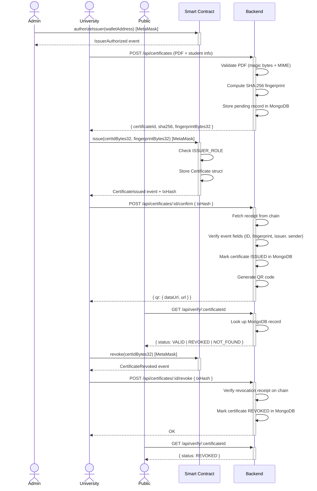

# CertiChain

> **Blockchain-anchored academic certificate issuance and verification platform.**

CertiChain enables authorized universities to issue tamper-proof digital diplomas whose **SHA-256 fingerprints are anchored on an Ethereum-compatible blockchain**. Any recruiter, employer or institution can verify a certificate in seconds — by **certificate ID**, by **uploading the original PDF**, or by **scanning a QR code** — without registering and without trusting CertiChain's servers. **The blockchain record is the source of truth.**

The diploma PDF and all student personal data are stored **off-chain** in the backend database. Only a non-identifying certificate ID, the document hash, the issuer wallet address and a timestamp are written **on-chain**, preserving student privacy.

---

## Table of Contents

- [The Problem](#the-problem)
- [The Solution](#the-solution)
- [Key Capabilities](#key-capabilities)
- [System Architecture](#system-architecture)
- [Technology Stack](#technology-stack)
- [Certificate Lifecycle](#certificate-lifecycle)
- [Security and Privacy](#security-and-privacy)
- [Project Structure](#project-structure)
- [Prerequisites](#prerequisites)
- [Installation and Setup](#installation-and-setup)
- [Environment Variables](#environment-variables)
- [Running the Application](#running-the-application)
- [Application Routes](#application-routes)
- [API Reference](#api-reference)
- [Smart Contract](#smart-contract)
- [Testing](#testing)
- [Screenshots](#screenshots)
- [Limitations and Future Improvements](#limitations-and-future-improvements)
- [Documentation Index](#documentation-index)
- [Academic Project Information](#academic-project-information)

---

## The Problem

Academic credential fraud is a growing global concern:

- **Document forgery** — printed diplomas are trivially replicated or altered.
- **Difficult manual verification** — employers must contact institutions directly, a slow and unreliable process.
- **Lack of transparency** — no public, immutable record of issued credentials exists.
- **Time-consuming processes** — verification can take days or weeks and is never guaranteed to reach the right person.

## The Solution

CertiChain addresses these issues with a layered approach:

| Mechanism | How it helps |
|---|---|
| **SHA-256 document fingerprinting** | Any byte-level change to a PDF produces a completely different hash — tampering is instantly detectable. |
| **Blockchain certificate anchoring** | The hash and certificate ID are stored immutably on-chain; no central authority can alter or delete them. |
| **University wallet authorization** | Only wallets explicitly granted `ISSUER_ROLE` by the platform admin can issue certificates — enforced by the smart contract, not just the API. |
| **Public verification** | Anyone can verify a certificate by ID or by uploading the PDF — no account required. |
| **Certificate revocation** | Issuing universities (and the admin) can revoke certificates on-chain; public verification immediately reflects the revoked state. |

---

## Key Capabilities

| Capability | Description |
|---|---|
| **Certificate issuance** | An authorized university uploads a diploma PDF; the backend computes its SHA-256 fingerprint; the university's MetaMask wallet anchors the fingerprint on-chain via `issue()`. |
| **Public verification** | Verify by certificate ID, by PDF upload (hash comparison), or via a QR code deep-link — no account required. |
| **Certificate revocation** | The issuing university (or admin) calls `revoke()` with MetaMask; public verification then reports `REVOKED`. |
| **University authorization** | The platform admin grants or revokes on-chain issuer rights (`ISSUER_ROLE`) from their MetaMask wallet. |
| **On-chain enforcement** | The smart contract rejects any issuance attempt from a non-authorized wallet — even if the API layer is bypassed. |
| **Immutable audit trail** | Issuance, revocation and authorization events are stored on-chain; the backend also maintains an append-only activity log. |
| **Zero backend private keys** | The backend has **read-only** blockchain access. Every chain write is signed exclusively in MetaMask. |
| **QR code generation** | The backend generates a QR code for every issued certificate, linking directly to the public verification page. |

---

## System Architecture

```mermaid
flowchart TD
    subgraph Actors
        A[Administrator]
        U[University User]
        R[Recruiter / Public]
    end

    subgraph Frontend ["React SPA (Vite · port 5173)"]
        LP[Landing Page]
        LG[Login Page]
        AD[Admin Dashboard]
        UD[University Dashboard]
        IW[Issuance Wizard]
        CD[Certificate Detail]
        VP[Verify Page]
    end

    subgraph MM [MetaMask]
        MW[Admin Wallet]
        UW[University Wallet]
    end

    subgraph Backend ["Express REST API (Node.js · port 5000)"]
        AUTH[Auth Middleware\nJWT · bcrypt · RBAC]
        CTRL[Controllers\nAuth · Admin · Certificate · Verify]
        SVC[Blockchain Service\nethers.js read-only]
        HASH[SHA-256 Fingerprinting\nNode.js crypto]
        QR[QR Code Generator\nqrcode]
    end

    subgraph DB [MongoDB]
        USERS[(Users)]
        UNIS[(Universities)]
        CERTS[(Certificates)]
        AUDIT[(Audit Log)]
    end

    subgraph Chain ["Hardhat Blockchain (chainId 31337)"]
        SC["CertificateRegistry.sol\nOpenZeppelin AccessControl\nSolidity 0.8.24"]
    end

    A -->|Dashboard| AD
    U -->|Dashboard / Wizard| UD & IW & CD
    R -->|Verification| LP & VP

    AD -->|Authorize wallet via| MW
    IW -->|Sign issue() via| UW
    CD -->|Sign revoke() via| UW

    AD & UD & IW & CD & VP -->|REST /api/*| CTRL
    LP -->|REST /api/verify/*| CTRL

    CTRL --> AUTH
    CTRL --> SVC
    CTRL --> HASH
    CTRL --> QR
    CTRL --> DB

    SVC -->|read-only eth_call| SC
    MW & UW -->|MetaMask tx| SC
```

### Component Responsibilities

| Component | Responsibility |
|---|---|
| **React SPA** | Admin and university dashboards; public landing and verification pages; MetaMask wallet integration via ethers.js v6. |
| **Express API** | JWT authentication, role-based access control, PDF upload and SHA-256 hashing, blockchain receipt verification, QR code generation, audit logging. |
| **MongoDB** | Off-chain storage of user accounts, university records, certificate metadata, student details and audit events. |
| **CertificateRegistry.sol** | On-chain source of truth: stores certificate ID, SHA-256 fingerprint, issuer address and timestamps; enforces `ISSUER_ROLE` via OpenZeppelin `AccessControl`. |
| **MetaMask** | The only component that holds private keys. Signs every blockchain write (authorize, issue, revoke) in the user's browser. |

---

## Technology Stack

### Frontend

| Package | Version | Purpose |
|---|---|---|
| `react` | ^18.3.1 | UI framework |
| `react-dom` | ^18.3.1 | DOM renderer |
| `react-router-dom` | ^6.28.0 | Client-side routing |
| `ethers` | ^6.13.4 | MetaMask / blockchain interaction |
| `axios` | ^1.7.9 | HTTP client for the REST API |
| `lucide-react` | ^1.72.0 | Icon library |
| `vite` | ^5.4.11 | Build tool and dev server |
| `@vitejs/plugin-react` | ^4.3.4 | React fast-refresh plugin |

Styling is **vanilla CSS** with a custom design system (no Tailwind, no component library).

### Backend

| Package | Version | Purpose |
|---|---|---|
| `express` | ^4.21.2 | HTTP server and routing |
| `mongoose` | ^8.8.0 | MongoDB ODM |
| `jsonwebtoken` | ^9.0.2 | JWT issuance and verification (HS256) |
| `bcryptjs` | ^2.4.3 | Password hashing |
| `multer` | ^2.0.1 | PDF multipart upload handling |
| `ethers` | ^6.13.4 | Read-only blockchain access |
| `helmet` | ^8.0.0 | HTTP security headers |
| `express-rate-limit` | ^7.4.1 | API rate limiting |
| `express-validator` | ^7.2.1 | Request body validation |
| `qrcode` | ^1.5.4 | QR code generation |
| `cors` | ^2.8.5 | CORS policy enforcement |
| `dotenv` | ^16.4.5 | Environment variable loading |

### Blockchain

| Package | Version | Purpose |
|---|---|---|
| `hardhat` | ^2.22.17 | Ethereum development environment |
| `@nomicfoundation/hardhat-toolbox` | ^5.0.0 | Testing, coverage, ethers, typechain |
| `@openzeppelin/contracts` | ^5.0.2 | `AccessControl` base contract |
| `dotenv` | ^16.4.5 | Environment variable loading |

Solidity compiler: **0.8.24** with optimizer enabled (200 runs).

---

## Certificate Lifecycle



> **Privacy note:** The diploma PDF and all student personal information (name, email, program, degree) remain exclusively in MongoDB. The blockchain stores only the certificate ID (`bytes32`), the SHA-256 fingerprint (`bytes32`), the issuer wallet address and a Unix timestamp — none of which identifies the student.

---

## Security and Privacy

| Mechanism | Detail |
|---|---|
| **SHA-256 fingerprinting** | The PDF hash is computed **server-side** using Node.js `crypto`. Any modification to the original file — including a single byte — produces a different hash and fails verification. |
| **JWT authentication** | HS256 tokens, configurable expiry (default 8 h). Validated on every protected route. |
| **bcrypt password hashing** | Configurable rounds (default 12) via `BCRYPT_ROUNDS`. |
| **Role-based access control** | Three roles (`admin`, `university`, public). Protected routes enforce roles in middleware before reaching controllers. |
| **Smart contract authorization** | `ISSUER_ROLE` is enforced on-chain by OpenZeppelin `AccessControl`. Even direct RPC calls from an unauthorized wallet are rejected by the contract. |
| **MetaMask transaction signing** | No private key ever touches the backend. All chain writes are signed in the user's browser wallet. |
| **Backend receipt verification** | When the frontend claims a transaction succeeded, the backend independently fetches the receipt and verifies the event name, certificate ID, fingerprint, issuer address and `tx.from` before trusting it. |
| **On-chain / off-chain separation** | Personal data and PDFs are stored only in MongoDB and are never returned by any public endpoint. |
| **HTTP security headers** | `helmet` sets `Content-Security-Policy`, `X-Frame-Options`, `X-Content-Type-Options` and related headers. |
| **Rate limiting** | Global, auth, verify and upload limiters protect all endpoints. Auth limiter is bypassed in `NODE_ENV=development` to ease local testing. |
| **PDF validation** | Uploads are validated by magic bytes (`%PDF`) and MIME type. Files are stored under random UUID filenames in a non-web-accessible directory. |

> **Hardhat development accounts** (account #0 and #1) are publicly known test-only keys bundled with Hardhat. **Never use them on a real network.**

---

## Project Structure

```
CertiChain/
│
├── blockchain/                   # Hardhat smart contract workspace
│   ├── contracts/
│   │   └── CertificateRegistry.sol   # Main contract (Solidity 0.8.24, OpenZeppelin AccessControl)
│   ├── scripts/
│   │   └── deploy.js             # Deployment script (local + Sepolia)
│   ├── test/
│   │   └── CertificateRegistry.test.js
│   ├── artifacts/                # Compiled contract artifacts (auto-generated)
│   ├── coverage/                 # Solidity coverage report (auto-generated)
│   ├── hardhat.config.js
│   ├── get-account.js            # Helper to print Hardhat account addresses
│   └── package.json
│
├── backend/                      # Node.js / Express REST API
│   ├── src/
│   │   ├── server.js             # HTTP server entry point
│   │   ├── app.js                # Express app factory (middleware, routes)
│   │   ├── config/
│   │   │   ├── env.js            # Centralised env validation (fails fast at boot)
│   │   │   ├── db.js             # MongoDB connection
│   │   │   ├── constants.js      # Shared constants (roles, etc.)
│   │   │   └── certificateRegistry.abi.json
│   │   ├── controllers/          # auth, admin, certificate, verify
│   │   ├── middleware/           # auth (JWT), rateLimiter, rbac, validate, errorHandler, upload
│   │   ├── models/               # Mongoose schemas (User, University, Certificate, AuditLog)
│   │   ├── routes/               # auth.routes, admin.routes, certificate.routes, verify.routes
│   │   ├── services/             # blockchainService.js (read-only ethers.js)
│   │   └── utils/                # Shared utilities
│   ├── scripts/
│   │   ├── seed.js               # Creates / resets the platform admin account
│   │   └── e2e-demo.js           # Full end-to-end demo script
│   ├── tests/
│   │   ├── setup.js              # Jest global setup (NODE_ENV=test, separate DB)
│   │   ├── security.test.js      # Security and lifecycle integration tests
│   │   └── rateLimit.test.js     # Rate-limiting tests (SEC-12)
│   ├── uploads/                  # PDF storage (gitignored, UUID filenames)
│   ├── .env.example
│   └── package.json
│
├── frontend/                     # React + Vite single-page application
│   ├── src/
│   │   ├── main.jsx              # React entry point
│   │   ├── App.jsx               # React Router route definitions
│   │   ├── index.css             # Global CSS reset
│   │   ├── styles/               # CSS design system (tokens, components, utilities)
│   │   ├── pages/
│   │   │   ├── Landing.jsx       # Public landing page with verification widget
│   │   │   ├── Login.jsx         # Shared login page (admin + university)
│   │   │   ├── VerifyLookupPage.jsx   # Interactive verification panel (ID or PDF)
│   │   │   ├── VerifyPage.jsx    # Deep-link result for a specific certificate
│   │   │   ├── NotFound.jsx      # 404 page
│   │   │   ├── admin/
│   │   │   │   └── AdminDashboard.jsx
│   │   │   └── university/
│   │   │       ├── UniversityDashboard.jsx
│   │   │       ├── IssueCertificate.jsx   # 4-step issuance wizard
│   │   │       └── CertificateDetail.jsx
│   │   ├── components/
│   │   │   ├── ProtectedRoute.jsx
│   │   │   ├── NavBar.jsx
│   │   │   ├── StatusBadge.jsx
│   │   │   ├── VerificationResult.jsx
│   │   │   ├── VerifyPanel.jsx
│   │   │   ├── layout/           # PublicLayout, DashboardLayout
│   │   │   └── ui/               # Button, Field, Dropzone, Stepper, Toast, etc.
│   │   ├── api/                  # axios client configuration
│   │   ├── auth/                 # AuthContext (JWT state management)
│   │   ├── lib/                  # Shared utilities (format, etc.)
│   │   └── web3/                 # contract.js (ethers.js contract bindings)
│   ├── vite.config.js            # Vite config (dev proxy /api → port 5000)
│   └── package.json
│
├── docs/                         # Project documentation
│   ├── 01-requirements.md
│   ├── 02-architecture.md
│   ├── 03-folder-structure.md
│   ├── 04-security.md
│   ├── 05-risks.md
│   ├── 06-roadmap.md
│   ├── 07-ai-usage-log.md
│   └── test-report.md
│
├── .gitignore
├── .gitattributes
└── README.md
```

---

## Prerequisites

Before installing CertiChain, ensure the following are available on your system:

| Prerequisite | Recommended version | Notes |
|---|---|---|
| **Node.js** | 20 LTS or later | Includes npm |
| **MongoDB Community Server** | 7.x or later | Must be running locally on `127.0.0.1:27017` |
| **MetaMask** browser extension | Latest | Required to sign blockchain transactions in the UI |
| **Git** | Any recent version | For cloning the repository |

---

## Installation and Setup

> **Important:** start the components in the exact order described below. The local Hardhat node **must remain running** throughout your demo session.

### Step 1 — Clone the repository

```bash
git clone <repository-url>
cd CertiChain
```

### Step 2 — Blockchain: install dependencies

```bash
cd blockchain
npm install
```

### Step 3 — Backend: install dependencies and configure environment

```bash
cd backend
npm install
copy .env.example .env
```

Open `backend/.env` in a text editor and set:

```ini
JWT_SECRET=<generate with: node -e "console.log(require('crypto').randomBytes(64).toString('hex'))">
CONTRACT_ADDRESS=0x5FbDB2315678afecb367f032d93F642f64180aa3
```

All other values in `.env.example` are pre-configured for local development and can be left as-is.

> **`.env` files are listed in `.gitignore` and must never be committed.**

### Step 4 — Frontend: install dependencies

```bash
cd frontend
npm install
```

---

## Running the Application

Start each component in a **separate terminal window**, in this order:

### Terminal 1 — Start the local Hardhat blockchain node

```bash
cd blockchain
npm run node
# Hardhat node running on http://127.0.0.1:8545, chainId 31337
# Leave this terminal open for the entire session.
```

### Terminal 2 — Deploy the smart contract

```bash
cd blockchain
npm run deploy:local
# Outputs the deployed contract address (default: 0x5FbDB2315678afecb367f032d93F642f64180aa3)
```

Copy the printed contract address and confirm it matches `CONTRACT_ADDRESS` in `backend/.env` and `VITE_CONTRACT_ADDRESS` in `frontend/.env` (if set).

### Terminal 3 — Seed and start the backend API

```bash
cd backend
npm run seed       # Creates the platform admin account from .env credentials
npm start          # API running on http://localhost:5000
```

Verify the backend is healthy:

```
http://localhost:5000/api/health
```

The response should include `"blockchain": { "connected": true }`.

### Terminal 4 — Start the frontend dev server

```bash
cd frontend
npm run dev        # SPA running on http://localhost:5173
```

Open `http://localhost:5173` in your browser.

### MetaMask Setup

Add the local Hardhat network to MetaMask and import the demo wallets:

| Setting | Value |
|---|---|
| Network name | Hardhat Localhost |
| RPC URL | `http://127.0.0.1:8545` |
| Chain ID | `31337` |
| Currency symbol | ETH |

| Role | Address | Private key |
|---|---|---|
| **Admin wallet** (account #0) | `0xf39Fd6e51aad88F6F4ce6aB8827279cffFb92266` | `0xac0974bec39a17e36ba4a6b4d238ff944bacb478cbed5efcae784d7bf4f2ff80` |
| **University wallet** (account #1) | `0x70997970C51812dc3A010C7d01b50e0d17dc79C8` | `0x59c6995e998f97a5a0044966f0945389dc9e86dae88c7a8412f4603b6b78690d` |

> These are **Hardhat's publicly known development keys** — they are listed in Hardhat's own documentation. **Never use them on any real network.**

---

## Environment Variables

### `backend/.env`

| Variable | Required | Default | Description |
|---|---|---|---|
| `NODE_ENV` | No | `development` | Runtime environment (`development`, `test`, `production`) |
| `PORT` | No | `5000` | HTTP port for the Express server |
| `MONGO_URI` | No | `mongodb://127.0.0.1:27017/certichain` | MongoDB connection string |
| `JWT_SECRET` | **Yes** | — | 64-byte random hex string for signing JWTs |
| `JWT_EXPIRES_IN` | No | `8h` | JWT expiry duration |
| `BCRYPT_ROUNDS` | No | `12` | bcrypt hashing rounds |
| `RPC_URL` | No | `http://127.0.0.1:8545` | Blockchain JSON-RPC endpoint (read-only) |
| `CHAIN_ID` | No | `31337` | Expected chain ID |
| `CONTRACT_ADDRESS` | **Yes** | — | Deployed `CertificateRegistry` address |
| `FRONTEND_ORIGIN` | No | `http://localhost:5173` | CORS allowed origin |
| `PUBLIC_BASE_URL` | No | `http://localhost:5173` | Base URL used in generated QR code links |
| `MAX_UPLOAD_BYTES` | No | `10485760` (10 MB) | Maximum PDF upload size |
| `RATE_LIMIT_GLOBAL` | No | `300` | Global rate limit (requests per 15-minute window) |
| `RATE_LIMIT_AUTH` | No | `10` | Auth endpoint rate limit (bypassed in `development`) |
| `RATE_LIMIT_VERIFY` | No | `60` | Verify endpoint rate limit |
| `RATE_LIMIT_UPLOAD` | No | `30` | Upload endpoint rate limit |
| `ADMIN_EMAIL` | No | `admin@certichain.local` | Platform admin email (used by `npm run seed`) |
| `ADMIN_PASSWORD` | No | `CertiChain-Admin-2026!` | Platform admin password (used by `npm run seed`) |

### `frontend/.env` (optional)

| Variable | Default (in code) | Description |
|---|---|---|
| `VITE_CONTRACT_ADDRESS` | `0x5FbDB2315678afecb367f032d93F642f64180aa3` | Deployed contract address |
| `VITE_CHAIN_ID` | `31337` | Expected chain ID |
| `VITE_CHAIN_NAME` | `Hardhat Localhost` | Display name shown in the UI |

### `blockchain/.env` (optional)

| Variable | Description |
|---|---|
| `LOCAL_RPC_URL` | Override for the local Hardhat node URL (default: `http://127.0.0.1:8545`) |
| `SEPOLIA_RPC_URL` | Sepolia RPC endpoint — **only needed for Sepolia deployment** |
| `DEPLOYER_PRIVATE_KEY` | Sepolia deployer wallet key — **only needed for Sepolia deployment, never commit** |

---

## Application Routes

### Public routes (no authentication required)

| Route | Page | Description |
|---|---|---|
| `/` | Landing | Project introduction with an embedded verification widget |
| `/login` | Login | Shared login page for admin and university users |
| `/verify/lookup` | Verification lookup | Interactive panel: verify by ID or by PDF upload |
| `/verify/:certificateId` | Verification result | Deep-link result for a specific certificate (used by QR codes) |

### Admin routes (requires `admin` JWT)

| Route | Page | Description |
|---|---|---|
| `/admin` | Admin Dashboard | University registration, wallet authorization/deauthorization, activity log |

### University routes (requires `university` JWT)

| Route | Page | Description |
|---|---|---|
| `/university` | University Dashboard | List of issued certificates, wallet connection status |
| `/university/issue` | Issue Certificate | 4-step wizard: student info → PDF upload → fingerprint → on-chain issuance |
| `/university/certificate/:certificateId` | Certificate Detail | Full certificate details, QR code, revocation |

---

## API Reference

All endpoints are prefixed with `/api`.

| Method | Path | Auth | Description |
|---|---|---|---|
| `GET` | `/health` | Public | Server and blockchain health check |
| `POST` | `/auth/login` | Public (rate-limited) | Obtain a JWT token |
| `GET` | `/auth/me` | Any JWT | Current identity and linked university |
| `GET` | `/admin/universities` | `admin` | List all registered universities |
| `POST` | `/admin/universities` | `admin` | Register a new university |
| `POST` | `/admin/universities/:id/confirm-authorization` | `admin` | Verify on-chain wallet authorization |
| `POST` | `/admin/universities/:id/confirm-deauthorization` | `admin` | Verify on-chain wallet deauthorization |
| `GET` | `/admin/activity` | `admin` | Paginated audit log |
| `GET` | `/certificates` | `university` | List the university's certificates |
| `POST` | `/certificates` | `university` | Upload PDF → compute SHA-256 → create pending record |
| `GET` | `/certificates/:id` | `university` | Certificate detail including QR code |
| `POST` | `/certificates/:id/confirm` | `university` | Verify on-chain issuance receipt |
| `POST` | `/certificates/:id/revoke` | `university` | Verify on-chain revocation receipt |
| `GET` | `/verify/:certificateId` | Public | Verify certificate by ID |
| `POST` | `/verify/file` | Public (rate-limited) | Verify by PDF upload (multipart `pdf` field) |

---

## Smart Contract

**Contract:** `CertificateRegistry` — [`blockchain/contracts/CertificateRegistry.sol`](blockchain/contracts/CertificateRegistry.sol)

**Standard:** Solidity 0.8.24, OpenZeppelin `AccessControl` v5

### Roles

| Role | Holder | Permissions |
|---|---|---|
| `DEFAULT_ADMIN_ROLE` | Deployer (platform admin wallet) | Grant/revoke `ISSUER_ROLE`; emergency-revoke any certificate |
| `ISSUER_ROLE` | One address per authorized university | Issue certificates; revoke certificates issued by that wallet |

### Functions

| Function | Visibility | Description |
|---|---|---|
| `issue(bytes32 certificateId, bytes32 fingerprint)` | `external` — `ISSUER_ROLE` only | Anchor a certificate fingerprint on-chain |
| `revoke(bytes32 certificateId)` | `external` — issuer or admin | Revoke an existing certificate |
| `verify(bytes32 certificateId, bytes32 fingerprint)` | `external view` | Returns `true` if certificate exists, fingerprint matches and is not revoked |
| `getCertificate(bytes32 certificateId)` | `external view` | Returns full certificate data (issuer, fingerprint, timestamps, exists flag) |
| `authorizeIssuer(address issuer)` | `external` — `DEFAULT_ADMIN_ROLE` | Grant `ISSUER_ROLE` to a university wallet |
| `deauthorizeIssuer(address issuer)` | `external` — `DEFAULT_ADMIN_ROLE` | Revoke `ISSUER_ROLE` from a university wallet |
| `isIssuerAuthorized(address issuer)` | `external view` | Convenience role check for UIs and the backend |

### Events

| Event | Emitted when |
|---|---|
| `CertificateIssued(bytes32 certificateId, address issuer, bytes32 fingerprint, uint64 timestamp)` | A certificate is issued |
| `CertificateRevoked(bytes32 certificateId, address revokedBy, uint64 timestamp)` | A certificate is revoked |
| `IssuerAuthorized(address issuer, address authorizedBy, uint64 timestamp)` | A university wallet receives `ISSUER_ROLE` |
| `IssuerDeauthorized(address issuer, address deauthorizedBy, uint64 timestamp)` | A university wallet loses `ISSUER_ROLE` |

---

## Demo Walkthrough

1. **Admin login** — open `http://localhost:5173/login` and sign in as `admin@certichain.local`.
2. **Register a university** — in the Admin Dashboard, create a university and set its ETH wallet address to Hardhat account #1 (`0x70997970C51812dc3A010C7d01b50e0d17dc79C8`).
3. **Authorize the university** — connect the admin MetaMask wallet (account #0), click **Authorize** and confirm in MetaMask. The backend verifies the on-chain `IssuerAuthorized` event.
4. **University login** — sign in as the university account (created during university registration).
5. **Issue a certificate** — navigate to **Issue Certificate** and complete the 4-step wizard:
   - Enter student name, email, program and degree.
   - Upload a diploma PDF (max 10 MB).
   - Review the SHA-256 fingerprint computed server-side.
   - Connect university MetaMask wallet (account #1), click **Sign & Issue On-Chain** and confirm in MetaMask.
6. **Verify** — scan the QR code or visit the printed URL — the result should be **VALID**.
7. **Tamper test** — upload the same PDF after changing a single byte → result is **NOT FOUND** (never VALID).
8. **Revoke** — open the certificate detail page, click **Revoke**, sign with MetaMask → public verification now shows **REVOKED**.
9. **Deauthorize** — in the Admin Dashboard, deauthorize the university → any further `issue()` call reverts on-chain.

---

## Testing

### Smart Contract Tests

```bash
cd blockchain
npm test          # Runs Hardhat/Mocha tests against an in-process Hardhat network
npm run coverage  # Generates Solidity statement coverage report
```

### Backend Tests

```bash
cd backend
npm test          # Jest + Supertest; uses a separate certichain_test database
```

The test suite includes:
- **`rateLimit.test.js`** — SEC-12: verifies that the auth rate limiter triggers a `429` after the configured threshold.
- **`security.test.js`** — Security and lifecycle integration tests covering authentication, authorization, issuance, revocation and public verification.

> **Known issue:** some tests in `security.test.js` currently fail due to a pre-existing issue with the university creation fixture, unrelated to the core security or rate-limiting functionality. See [`docs/test-report.md`](docs/test-report.md) for the full executed results and honest limitations.

### End-to-End Demo Script

```bash
# Requires: mongod running, Hardhat node running, contract deployed, backend running
cd backend
npm run e2e
```

### Frontend Production Build

```bash
cd frontend
npm run build     # Outputs to frontend/dist/
```

---

## Screenshots

> **Note:** screenshots directory is created below. Add actual screenshots to `docs/screenshots/` to populate this section.

### Landing Page
*Public homepage with integrated certificate verification widget.*

`docs/screenshots/01-landing.png`

### Admin Dashboard
*University registration, wallet authorization and activity log.*

`docs/screenshots/02-admin-dashboard.png`

### University Dashboard
*Issued certificates list with status badges and wallet connection indicator.*

`docs/screenshots/03-university-dashboard.png`

### Certificate Issuance Wizard
*4-step wizard: student info → PDF upload → SHA-256 fingerprint → MetaMask signing.*

`docs/screenshots/04-issuance-wizard.png`

### Certificate Detail
*Full certificate metadata, QR code and revocation controls.*

`docs/screenshots/05-certificate-detail.png`

### Public Verification — Valid Certificate
*Verification result showing VALID status with certificate metadata.*

`docs/screenshots/06-verify-valid.png`

### Public Verification — Revoked Certificate
*Verification result showing REVOKED status.*

`docs/screenshots/07-verify-revoked.png`

### Public Verification — Not Found
*Verification result when no matching certificate exists (tampered PDF).*

`docs/screenshots/08-verify-not-found.png`

---

## Limitations and Future Improvements

The following are **not yet implemented** and are on the post-MVP roadmap:

| Improvement | Description |
|---|---|
| **Sepolia testnet deployment** | The contract and scripts support Sepolia (`npm run deploy:sepolia`) but the platform currently runs on a local Hardhat node only. A funded Sepolia deployer wallet and RPC endpoint are required. |
| **IPFS document storage** | PDFs are stored on the backend server. Future versions could pin documents to IPFS for decentralised storage, while keeping personal student data off-chain. |
| **Student portal** | A self-service portal where students can view and share their own certificates. |
| **Production wallet infrastructure** | Hardware Security Modules (HSMs) or multi-signature wallets for production admin keys. |
| **Advanced analytics** | Certificate issuance trends, verification statistics and institutional reporting. |
| **Additional institutional integrations** | API integrations with university information systems (SIS), HR platforms and verification services. |

---

## Documentation Index

| Document | Contents |
|---|---|
| [docs/01-requirements.md](docs/01-requirements.md) | Scope, actors, use cases, functional and non-functional requirements |
| [docs/02-architecture.md](docs/02-architecture.md) | System architecture, on-chain/off-chain model, data flows, MetaMask signing model |
| [docs/03-folder-structure.md](docs/03-folder-structure.md) | Monorepo folder structure and conventions |
| [docs/04-security.md](docs/04-security.md) | Threat model (STRIDE), OWASP mapping, security requirements, test plan, residual risks |
| [docs/05-risks.md](docs/05-risks.md) | Technical risk register with mitigations |
| [docs/06-roadmap.md](docs/06-roadmap.md) | Development plan and post-MVP backlog |
| [docs/07-ai-usage-log.md](docs/07-ai-usage-log.md) | Generative-AI usage record and verification protocol (criterion D) |
| [docs/test-report.md](docs/test-report.md) | Executed test results, deviations and honest limitations |

---

## Academic Project Information

| Field | Detail |
|---|---|
| **Project type** | Final-year university project |
| **Module** | Blockchain Application Development / Blockchain & Cybersecurity |
| **Project name** | CertiChain |
| **Evaluation criteria** | (A) Blockchain concepts and solution design · (B) Smart contract development, security and testing · (C) Technical questions and answers · (D) Responsible generative-AI usage |
| **Team members** | *(add names here)* |
| **Academic supervisor** | *(add name here)* |

The AI usage log (`docs/07-ai-usage-log.md`) and this repository's commit history form part of the assessed evidence for criterion D.

---

*CertiChain — making academic credentials trustworthy, verifiable and fraud-resistant.*
