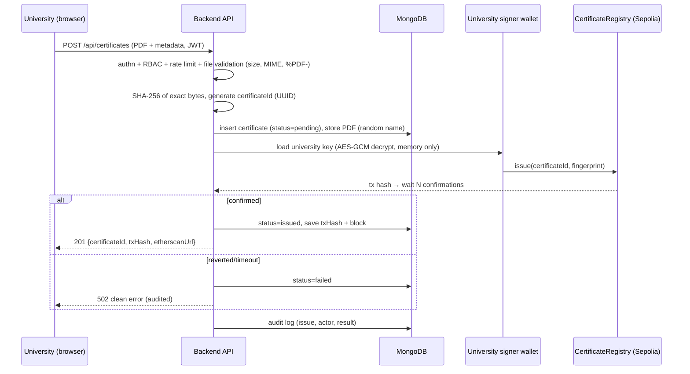

# CertiChain — System Architecture

| | |
|---|---|
| **Phase** | 0 — Planning |
| **Version** | 1.0 (2026-11-11) |
| **Status** | Awaiting team review and approval |

---

## 1. Design goals

1. **Tamper-evident verification** that survives even full compromise of CertiChain's servers (the public chain is the source of truth).
2. **Privacy by design**: no personal data on a public blockchain.
3. **Minimum viable complexity**: no technology that cannot be explained and defended by both students (evaluation criterion C).
4. **Demo-day reliability**: deterministic flows, no interactive wallet popups in the critical path.
5. **Testability**: every security property has an automated test.

## 2. Why blockchain for diploma verification? (Criterion A justification)

### 2.1 What we need from the ledger

A diploma verification system needs a record that is: (a) **append-only** (history cannot be rewritten), (b) **publicly readable** without permission from the issuing institution or CertiChain, (c) **independently checkable** by third parties, and (d) **timestamped** in a way nobody can backdate.

### 2.2 What a database alone cannot guarantee

A centralized database can be modified by its operators — maliciously, under coercion, or by mistake. A verifier has to *trust the operator*. Blockchain moves that trust into a protocol: once the fingerprint is confirmed on Sepolia, altering it requires reorganizing a public network.

### 2.3 The anchoring pattern (what real systems do)

Storing full PDFs on-chain is impossible (gas cost) and undesirable (privacy). CertiChain uses the **anchor pattern** — the same idea behind Blockcerts / MIT digital diplomas:

> Store the document off-chain; store a **cryptographic fingerprint** of it on-chain.

- **SHA-256** maps any file to a 256-bit digest. Any change to even one byte of the PDF changes the digest completely (**avalanche effect**). Finding a different file with the same digest (collision) or reconstructing the file from the digest (preimage) is computationally infeasible (2^128 / 2^256 search spaces).
- Verification = recompute SHA-256 of the held document and compare with the on-chain anchor. The chain answers: *was this exact document issued by an authorized university, and is it still valid?*

### 2.4 What blockchain does NOT do here (be honest in the defense)

- It does **not** prove the original diploma is *true* — garbage in, garbage out: if a university issues a fake diploma, the chain faithfully anchors a fake.
- It does **not** decentralize the *identity* of universities — the admin is the root of trust for who may issue.
- The on-chain hash of a document containing a student's name is *pseudonymous data* (see `docs/04-security.md` §9): someone holding a candidate PDF can test it against the chain. This trade-off is accepted because third-party hash verification is a core requirement (VER-02).

**One-paragraph defense answer:** *"Blockchain gives us a neutral, public, append-only witness. We deliberately do not use it for storage or identity — only for anchoring fingerprints and issuer authorization, which is exactly the part a database cannot make tamper-evident."*

### 2.5 Alternatives considered

| Alternative | Why rejected (for this project) |
|---|---|
| Signed PDFs + public key infrastructure | Verifiers must obtain and manage issuers' public keys; revocation lists still centralized; no public neutral history |
| Public database + digital signatures | Trust in the operator's availability and integrity; no independent audit trail; signature keys still need distribution |
| Permissioned chain (Hyperledger) | No public verifiability by recruiters; heavier ops; not aligned with course's Ethereum focus |
| Full document on-chain | Cost (a 100 KB PDF ≈ millions of gas) and privacy violation |

## 3. Technology choices and rationale

| Choice | Rationale |
|---|---|
| **Solidity / EVM** | Largest ecosystem, mature tooling (Hardhat, OpenZeppelin), abundant documentation for learning, directly matches course scope |
| **Sepolia testnet** | Public, free (test ETH), permanent-ish records, Etherscan explorer for transparent verification during the demo |
| **Hardhat** | Local network for fast deterministic dev; same contract deploys unchanged to Sepolia; built-in test runner and coverage |
| **OpenZeppelin AccessControl** | Battle-tested, audited role model (`DEFAULT_ADMIN_ROLE`, custom `ISSUER_ROLE`) — avoids hand-rolled access control bugs |
| **ethers.js v6** | Clean API for providers, signers, contract calls, receipts, events |
| **Node.js + Express** | Matches project brief; simple, well-understood middleware pipeline for auth/RBAC/validation |
| **MongoDB + Mongoose** | Matches brief; flexible schema for certificate metadata + audit logs; Atlas removes local install burden |
| **React + Vite + Tailwind** | Fast SPA build, responsive utility styling without heavy CSS frameworks |
| **QR codes (node-qrcode)** | QR encodes the public verification URL — any phone camera works, no app needed |

Version pinning happens in Phase 1 `package.json` files (recommended baseline: Node 22 LTS, Express 4.21.x, Mongoose 8.x, jsonwebtoken 9.x, bcrypt 5.1.1, ethers 6.x, hardhat 2.22.x, @openzeppelin/contracts 5.x, multer 2.x, helmet 8.x, express-rate-limit 7.x).

## 4. High-level architecture

```
                         ┌────────────────────────────────┐
                         │          WEB BROWSER            │
                         │  React SPA (Vite + Tailwind)    │
                         │  ─ Landing / Login / Register   │
                         │  ─ Admin dashboard             │
                         │  ─ University dashboard         │
                         │  ─ Student portal               │
                         │  ─ PUBLIC verification page     │
                         └───────────────┬────────────────┘
                                         │  HTTPS · REST (JSON, JWT Bearer)
                                         ▼
┌────────────────────────────────────────────────────────────────────┐
│                    BACKEND — Node.js + Express                       │
│                                                                     │
│  middleware:  auth(JWT) · RBAC · rate-limit · upload · audit ·     │
│               validation · error-handler                            │
│                                                                     │
│  services:    hash (SHA-256) · storage (PDFs) · blockchain (ethers) │
│               issuer-wallets (AES-256-GCM) · tx-queue · QR · audit │
└───────┬──────────────────┬──────────────────┬──────────────────────┘
        │                  │                  │  JSON-RPC over HTTPS
        ▼                  ▼                  ▼
┌───────────────┐  ┌───────────────┐  ┌────────────────────────────┐
│   MongoDB     │  │  Document     │  │   SEPOLIA TESTNET           │
│  users        │  │  storage      │  │   CertificateRegistry.sol   │
│  universities │  │  (PDFs,       │  │   ─ ISSUER_ROLE universities│
│  certificates │  │   access-     │  │   ─ SHA-256 anchors         │
│  auditlogs    │  │   controlled) │  │   ─ revocations + events    │
└───────────────┘  └───────────────┘  └────────────────────────────┘

   Out-of-band: MetaMask (team's admin account, contract deployment &
   emergency operations) · Etherscan (public inspection, UC-15)
```

Three layers, as required by the brief. **The backend is the only blockchain client** — the frontend never talks to the chain directly in the MVP.

## 5. Smart contract design — `CertificateRegistry.sol`

### 5.1 Roles

| Role | Holder | Powers |
|---|---|---|
| `DEFAULT_ADMIN_ROLE` | Backend admin wallet (deployer) | Grant/revoke `ISSUER_ROLE`, emergency revocation |
| `ISSUER_ROLE` | One dedicated address per authorized university | Issue certificates; revoke certificates they issued |

### 5.2 On-chain state (intentionally minimal)

```solidity
struct Certificate {
    address issuer;        // university signer that issued
    bytes32 fingerprint;   // SHA-256 of the original PDF bytes
    uint64  issuedAt;      // block timestamp (also acts as existence flag)
    uint64  revokedAt;     // 0 = active
}
mapping(bytes32 => Certificate) private _certificates;  // key: certificateId
```

Storage cost ≈ 3 slots per certificate (~80–90k gas) — a few cents of worthless test ETH, and the reason PDFs must stay off-chain.

### 5.3 External interface

| Function | Visibility | Access | Purpose |
|---|---|---|---|
| `issue(bytes32 certificateId, bytes32 fingerprint)` | external | `ISSUER_ROLE` | Register fingerprint; reverts on duplicate ID or zero fingerprint |
| `verify(bytes32 certificateId, bytes32 fingerprint)` | view | public | `true` ⇔ exists ∧ hash matches ∧ not revoked |
| `getCertificate(bytes32 certificateId)` | view | public | Issuer address, fingerprint, issuedAt, revokedAt |
| `revoke(bytes32 certificateId)` | external | issuer-of-record only | Sets `revokedAt`; reverts if absent, already revoked, or caller ≠ issuer |
| `authorizeIssuer(address issuer)` | external | admin | Grants `ISSUER_ROLE`; validates non-zero address |
| `deauthorizeIssuer(address issuer)` | external | admin | Revokes `ISSUER_ROLE` |
| `isIssuerAuthorized(address issuer)` | view | public | Role check for UI/status display |

Events (immutable history — FR "transaction history"): `CertificateIssued(certificateId, issuer, fingerprint, timestamp)`, `CertificateRevoked(certificateId, revokedBy, timestamp)`, `IssuerAuthorized(issuer, by, timestamp)`, `IssuerDeauthorized(issuer, by, timestamp)`.

### 5.4 Design rules honored

- **Checks-effects-interactions**: all input checks first, state mutations second, events last. No external calls exist in the contract.
- **Custom errors** (`revert CertificateAlreadyExists(id)`) instead of require-strings — cheaper, clearer in tests.
- **No ETH handling, no external calls, no delegatecall, no tx.origin** → reentrancy surface is empty (documented, not just asserted).
- **Zero-address / zero-value validation** on all mutating inputs (spec requirement).
- **Revocation reason stays off-chain** (gas + privacy); linked by certificate ID + revocation tx hash.
- **Deauthorization ≠ mass revocation**: existing certificates from a deauthorized university remain valid (documented semantic — the issuance was legitimate when made). Mass revocation is a possible future extension.
- **No upgradeability**: bugs cannot be patched in place. Mitigation: comprehensive tests before deployment; no funds at risk; redeploy strategy documented.

## 6. Transaction authorization & key management (critical decision)

**Requirement from the brief:** the backend performs all blockchain interaction, universities log in with email/password, and the contract must enforce per-university ownership. The design that satisfies all three:

1. When the admin authorizes a university, the backend **generates a dedicated Ethereum keypair** for it (the university's on-chain identity).
2. The private key is encrypted with **AES-256-GCM** using a master key from the environment and stored in MongoDB as ciphertext `{iv, tag, data}`.
3. On issuance/revocation, the backend decrypts the key **in memory only**, signs the transaction, and never persists or logs plaintext keys.
4. The contract sees `msg.sender` = the university's address → **issuer-ownership and authorization are enforced cryptographically on-chain**, per university.

### Alternatives considered

| Option | Pros | Cons | Verdict |
|---|---|---|---|
| **A. Backend-held per-university wallets (chosen)** | Backend owns chain interaction; deterministic demo; real per-university on-chain identity | Server-side key custody (documented risk §14) | ✅ MVP |
| B. Universities sign with MetaMask in-browser | True client-side signing, uses MetaMask interactively | Frontend becomes a chain client (contradicts brief); MetaMask popups during demo; wallet funding per user; split error handling | Rejected for MVP |
| C. One shared backend signer for all universities | Simplest | Destroys on-chain per-university authorization — the spec's issuer-ownership tests become meaningless | Rejected |

**MetaMask usage plan (it stays in the stack, honestly):** the team's admin account lives in MetaMask; it funds the service wallets on Sepolia and performs contract deployment + emergency admin operations (also demonstrable through Etherscan's *Write* tab). The public can inspect everything on Etherscan.

## 7. On-chain vs off-chain data

| Data | On-chain | Off-chain (MongoDB) | Why |
|---|---|---|---|
| Certificate ID (UUID) | ✅ | ✅ | Public non-identifying reference; DB for display/joins |
| SHA-256 fingerprint | ✅ | ✅ | Anchor (chain) + lookup index (DB) |
| Issuer address | ✅ | ✅ (mapping to university name) | Cryptographic issuer identity |
| issuedAt / revokedAt | ✅ | ✅ | Tamper-evident timeline |
| University name, contact | ❌ | ✅ | Display data; maps from issuer address |
| Student name, email | ❌ | ✅ | **PII — never on a public chain** |
| Program, degree, dates | ❌ | ✅ | PII-adjacent, bulky |
| PDF bytes | ❌ | ✅ (access-controlled store) | Cost + privacy |
| Revocation reason | ❌ | ✅ | Gas + free text privacy |
| Transaction hashes | — (derived) | ✅ | Etherscan links |

## 8. MongoDB data model

| Collection | Key fields |
|---|---|
| `users` | `email` (unique), `passwordHash`, `role` (`admin` \| `university` \| `student`), `universityId?`, `active`, `activationToken?` (students), `createdAt`, `lastLoginAt` |
| `universities` | `name`, `ethAddress` (unique), `encryptedSignerKey` `{iv, tag, data}`, `authorized` (mirror of on-chain state), `authorizedAt`, `deauthorizedAt?` |
| `certificates` | `certificateId` (UUID, unique), `sha256` (unique index), `universityId`, `studentName`, `studentEmail`, `program`, `degree`, `fileName` (original, sanitized), `storedFile` (server path), `sizeBytes`, `status` (`issued` \| `revoked` \| `failed`), `issueTxHash`, `issueBlock`, `revokeTxHash?`, `revokeReason?`, timestamps |
| `auditlogs` | `actor`, `actorRole`, `action`, `target`, `ip`, `userAgent`, `result` (`success` \| `failure`), `details`, `createdAt` — append-only |

## 9. Core flows

### 9.1 Certificate issuance (university)



### 9.2 Public verification by ID (recruiter, no auth)

1. `GET /api/verify/:certificateId` (rate-limited).
2. Backend calls `getCertificate(certId)` on-chain → issuer address, fingerprint, timestamps, revoked status.
3. DB enriches display: university name, program, degree (never student name/email — VER-06).
4. Response: status (`valid` | `revoked` | `not_found`), info, tx hashes + Etherscan links.
5. Chain is authoritative: if DB and chain disagree, chain wins (VER-05).

### 9.3 Public verification by PDF upload

1. `POST /api/verify/file` (multipart, rate-limited, same validation as issuance).
2. Backend computes SHA-256 of the uploaded bytes (client-supplied hashes are ignored — brief §7).
3. Look up hash in DB → certificate ID → confirm on-chain.
4. Result: `valid` (hash matches an active anchor) / `revoked` / `invalid_or_modified` (no anchor for these bytes — the document differs from the issued original) / `not_found`.

### 9.4 Revocation (university)

1. `POST /api/certificates/:id/revoke` (JWT + RBAC: owning university only — checked in API **and** re-checked by the contract).
2. Backend signs `revoke(certId)` with the same university wallet.
3. Contract verifies `msg.sender == certificate.issuer` (double enforcement of ownership).
4. DB updated (`revokedAt`, reason, tx hash); audit-logged; public page now shows REVOKED.

### 9.5 University authorization (admin)

1. Admin authorizes university → API creates user + generates signer keypair → encrypts and stores it.
2. Admin wallet calls `authorizeIssuer(universityAddress)` on-chain.
3. Deauthorization mirrors this with `deauthorizeIssuer` — the university's API access and on-chain rights are both removed.

## 10. Concurrency, nonces and confirmations

- **Nonce management**: one serialized promise-queue per wallet; on startup and after errors, sync with `getTransactionCount('pending')`. Prevents "nonce too low" replacement errors under concurrent issuance.
- **Confirmations**: wait 2–3 blocks on Sepolia before reporting success; on restart, any `pending` records are reconciled against the chain by receipt lookup.
- **Reads**: verification uses `eth_call` (no gas, fast); issuance status is reconciled from receipts.

## 11. API surface (overview)

| Method & path | Auth | Notes |
|---|---|---|
| `POST /api/auth/register` | public | Student activation (code-bound), rate-limited |
| `POST /api/auth/login` | public | Rate-limited, audit-logged |
| `GET  /api/auth/me` | JWT | Identity + role |
| `GET  /api/admin/universities` · `POST` · `PATCH /:id/deauthorize` | admin | On-chain + DB authorization management |
| `GET  /api/admin/activity` | admin | Paginated audit log |
| `POST /api/certificates` | university | Multipart issuance (PDF) |
| `GET  /api/certificates` · `GET /:id` | university | Own certificates only |
| `POST /api/certificates/:id/revoke` | university | Owning university only |
| `GET  /api/student/certificates` | student | Own (email-matched) only |
| `GET  /api/student/certificates/:id/download` · `GET /:id/qr` | student | PDF stream · QR PNG |
| `GET  /api/verify/:certificateId` | **public** | Status + info + tx refs (no PII) |
| `POST /api/verify/file` | **public** | PDF hash verification |

All endpoints: input validation, central error handler, audit logging where state changes or authorization failures occur.

## 12. QR code design

QR encodes `{FRONTEND_URL}/verify/{certificateId}` — a plain URL, so any phone camera opens the public verification page (UC-14). Generated server-side (`qrcode` package) as PNG data-URL; displayed in university/student dashboards.

## 13. Environments & deployment topology

| Environment | Chain | Wallets | Purpose |
|---|---|---|---|
| **Development** | Hardhat local node (chainId 31337) | Deterministic test accounts | Fast, free, reproducible contract tests |
| **Demo / "production"** | Sepolia via Alchemy/Infura RPC | Admin wallet (MetaMask), per-university service wallets | Public, verifiable, Etherscan-linked |

Deployment runbook (Phase 9): fund wallets → deploy `CertificateRegistry` → verify source on Etherscan (`hardhat-etherscan`) → set `CONTRACT_ADDRESS` in backend env → authorize universities → seed demo data → smoke test end-to-end.

## 14. Trust model & honest limitations

**Trust anchors:** the admin (root of trust for university identity) → universities (trustworthy issuance of genuine diplomas) → the chain (tamper-evidence of what was issued/revoked) → the backend (operational integrity, key custody).

**Documented limitations (to state openly in the report and defense):**

1. **Server-side key custody**: university signer keys live encrypted on the backend. A full server compromise could issue fraudulently *as a university* — though it still could not fake history on-chain. (Alternative B pushes custody to universities; complexity rejected for MVP.)
2. **Hash as pseudonymous data**: the anchor allows anyone holding a candidate PDF to test membership (by design — that is verification). Salting would break third-party hash verification (VER-02).
3. **Immutable contract**: no in-place bug fixes; redeploy is the recovery path. Mitigated by the test-first contract phase.
4. **Deauthorization is not retroactive**: certificates issued before deauthorization remain anchored as valid.
5. **The backend is a availability single point**: the *verification record* is decentralized, the *service* is not. Recruiters can always fall back to Etherscan (UC-15).

## 15. Open items to confirm at approval

- D1–D5 from `docs/01-requirements.md` §11 (language, Mongo hosting, JWT storage, student activation, duplicate policy).
- Confirm per-university wallet design (§6) — this is the decision the professor is most likely to probe; both students must be able to defend it.
