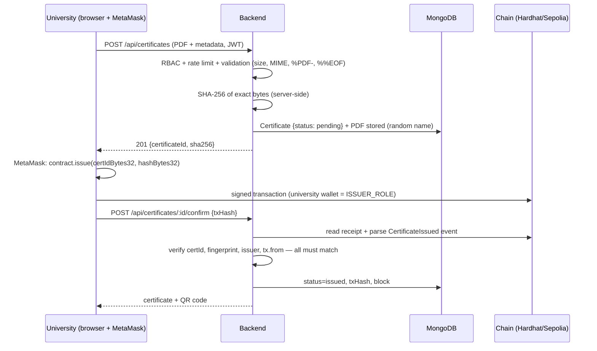

# CertiChain — System Architecture

| | |
|---|---|
| **Phase** | Emergency MVP (scope change) |
| **Version** | **2.0** (2026-11-11) — supersedes v1.0. Change: transaction signing moved from backend-held wallets to **MetaMask-held university wallets**; the backend now holds **zero private keys**. |
| **Status** | Implemented tonight — see `docs/test-report.md` for execution evidence |

---

## 1. Design goals

1. **Tamper-evident verification** that survives even full compromise of CertiChain's servers (public chain = source of truth).
2. **Privacy by design**: no personal data on-chain.
3. **Zero server-side key custody**: universities sign with their own MetaMask wallets; the backend never generates, stores or touches university private keys.
4. **Never trust the client**: the backend verifies every frontend-claimed blockchain action against the chain itself (events, sender, arguments).
5. **Demo-day reliability**: local Hardhat chain (chainId 31337) first; Sepolia optional afterwards.

## 2. Why blockchain for diploma verification? (Criterion A justification)

### 2.1 What we need from the ledger

A diploma verification system needs a record that is: (a) **append-only** (history cannot be rewritten), (b) **publicly readable** without permission from the issuing institution or CertiChain, (c) **independently checkable**, and (d) **timestamped** in a way nobody can backdate.

### 2.2 What a database alone cannot guarantee

A centralized database can be modified by its operators — maliciously, under coercion, or by mistake. A verifier must *trust the operator*. A blockchain moves that trust into a protocol: once the fingerprint is confirmed on-chain, altering it requires reorganizing the network.

### 2.3 The anchoring pattern

Storing full PDFs on-chain is impossible (gas cost) and undesirable (privacy). CertiChain stores the document off-chain and anchors a **SHA-256 fingerprint** on-chain — the same idea behind Blockcerts / MIT digital diplomas.

- **SHA-256** maps any file to a 256-bit digest. Changing one byte of the PDF changes the digest completely (**avalanche effect**). Finding a collision (2^128 birthday space) or a preimage (2^256) is computationally infeasible.
- Verification = recompute SHA-256 of the held document and compare with the on-chain anchor.

### 2.4 What blockchain does NOT do here (say this in the defense)

- It does **not** prove the original diploma is *true* — garbage in, garbage out.
- It does **not** decentralize university identity — the admin is the root of trust for who may issue.
- The on-chain hash of a document containing a student's name is *pseudonymous data* (accepted trade-off: public hash verification is a core requirement).

**One-paragraph defense answer:** *"Blockchain gives us a neutral, public, append-only witness. We use it for anchoring fingerprints, issuer authorization and revocation — exactly the part a database cannot make tamper-evident. We deliberately do not put documents or personal data on-chain."*

## 3. Technology choices

| Choice | Rationale |
|---|---|
| Solidity / EVM, Hardhat | Course scope; mature tooling; local deterministic chain (chainId 31337) then Sepolia unchanged |
| OpenZeppelin `AccessControl` | Audited role model: `DEFAULT_ADMIN_ROLE` (admin) + `ISSUER_ROLE` (universities) |
| ethers.js v6 (frontend + backend) | BrowserProvider + MetaMask on the frontend; read-only JsonRpcProvider on the backend |
| **MetaMask** | Signs issuance, revocation and university-authorization transactions — private keys stay in the users' wallets |
| Node.js + Express + MongoDB (local) | Brief requirement; `mongodb://127.0.0.1:27017/certichain`; no Docker, no Atlas |
| React + Vite + JavaScript + custom CSS | Fast SPA; zero build-tool complexity for tonight |
| SHA-256 via Node `crypto` | Backend computes hashes over the exact uploaded bytes — client-supplied hashes are never trusted |
| QR codes (`qrcode`) | QR encodes the public verification URL — any phone camera works |

## 4. High-level architecture

```
                    ┌───────────────────────────────────────┐
                    │             WEB BROWSER                │
                    │  React SPA (Vite)                      │
                    │  ─ Landing / Login                     │
                    │  ─ Admin dashboard (MetaMask: admin)  │
                    │  ─ University dashboard (MetaMask:    │
                    │     university wallet)                 │
                    │  ─ PUBLIC verification page            │
                    └──────┬───────────────────┬────────────┘
                           │ HTTPS·REST (JWT)  │ writes: issue / revoke /
                           ▼                   ▼ authorize (MetaMask-signed)
┌────────────────────────────────────┐   ┌─────────────────────────────┐
│ BACKEND — Node.js + Express        │   │  BLOCKCHAIN (Hardhat 31337 / │
│  auth(JWT) · RBAC · rate-limit     │   │  Sepolia optional later)     │
│  upload validation · SHA-256       │   │  CertificateRegistry.sol     │
│  QR · audit log · MongoDB          │   │  ─ ISSUER_ROLE universities  │
│                                    │   │  ─ SHA-256 anchors           │
│  blockchain.service (READ-ONLY:    │   │  ─ revocations + events     │
│  verify, parse receipts, roles)   │   └─────────────────────────────┘
│  ⚠ holds ZERO private keys         │
└───────┬────────────────────────────┘
        ▼
┌───────────────┐   ┌────────────────┐
│ MongoDB local │   │ uploads/ (PDF   │
│ 127.0.0.1:    │   │ store, random   │
│ 27017         │   │ filenames)     │
└───────────────┘   └────────────────┘
```

**Division of responsibility (critical for the defense):**

- **MetaMask (frontend)**: signs all *state-changing* transactions — `issue`, `revoke`, `authorizeIssuer`, `deauthorizeIssuer`. University private keys never exist anywhere except the user's own wallet.
- **Backend**: authentication, RBAC, file validation, **SHA-256 computation**, PDF storage, MongoDB, QR, audit — plus **read-only** blockchain access: verification queries, role checks, and *verification of frontend-claimed transactions* (receipt + event parsing).
- **Blockchain**: the source of truth for certificate status, issuer authorization and history.

## 5. Smart contract — `CertificateRegistry.sol`

### 5.1 Roles

| Role | Holder | Powers |
|---|---|---|
| `DEFAULT_ADMIN_ROLE` | Contract deployer (admin's MetaMask wallet) | Grant/revoke `ISSUER_ROLE`; emergency revocation |
| `ISSUER_ROLE` | One address per authorized university | Issue certificates; revoke certificates they issued |

### 5.2 On-chain state (minimal by design)

```solidity
struct Certificate {
    address issuer;        // university wallet that issued
    bytes32 fingerprint;   // SHA-256 of the original PDF bytes
    uint64  issuedAt;      // block timestamp (also the existence flag)
    uint64  revokedAt;     // 0 = active
}
mapping(bytes32 => Certificate) private _certificates;  // key: certificateId
```

On-chain data per certificate: **non-identifying ID, hash, issuer wallet, timestamps** — exactly the emergency-scope requirement. ≈3 storage slots ≈ 80–90k gas.

### 5.3 Interface

| Function | Access | Purpose |
|---|---|---|
| `issue(bytes32 certificateId, bytes32 fingerprint)` | `ISSUER_ROLE` | Register fingerprint; reverts on duplicate ID, zero ID/fingerprint |
| `verify(bytes32 certificateId, bytes32 fingerprint)` | view, public | `true` ⇔ exists ∧ hash matches ∧ not revoked |
| `getCertificate(bytes32 certificateId)` | view, public | issuer, fingerprint, issuedAt, revokedAt, exists |
| `revoke(bytes32 certificateId)` | issuer-of-record or admin | Sets `revokedAt`; reverts if absent/already revoked/foreign issuer |
| `authorizeIssuer(address)` / `deauthorizeIssuer(address)` | admin | University authorization on-chain |
| `isIssuerAuthorized(address)` | view | Role check |

Events (immutable history): `CertificateIssued`, `CertificateRevoked`, `IssuerAuthorized`, `IssuerDeauthorized`.

### 5.4 Security rules honored

- OpenZeppelin `AccessControl`; custom errors; checks-effects-interactions (events last).
- Zero-address validation (authorize), zero ID/fingerprint validation (issue).
- Duplicate issuance and repeated revocation revert with custom errors.
- Revocation restricted to the certificate's issuer-of-record or admin. **Documented semantic:** a *deauthorized* university can no longer issue (role check) but can still revoke its own past certificates — blocking revocation would protect fraudsters, not users.
- No ETH transfers, no external calls → empty reentrancy surface (analyzed, not just asserted).
- Solidity ≥ 0.8.24 checked arithmetic; no `tx.origin`, no assembly, no unbounded loops.
- No upgradeability (bugs → redeploy; documented recovery path).

### 5.5 Certificate ID ↔ bytes32 mapping

The certificate ID is a **UUID v4** generated by the backend. On-chain it is the UUID's 32 hex digits zero-padded to a `bytes32` word: `0x<uuid-hex-without-dashes>0000000000000000000000000000`. Deterministic, bijective, and explainable in the defense.

## 6. Transaction authorization — MetaMask model (v2.0 decision)

### 6.1 The rule

**The backend never generates, stores, or uses private keys of any kind.** All blockchain writes are signed by MetaMask in the user's browser. The backend's chain access is **read-only** (RPC provider without a signer).

### 6.2 The trust problem this creates — and its solution

If the frontend tells the backend "issuance happened, here is the tx hash", a malicious client could lie. Therefore **the backend never trusts frontend claims — it verifies them on-chain**:

`POST /api/certificates/:id/confirm { txHash }` is only accepted if the backend, reading the chain itself, finds in that transaction's receipt:

1. a `CertificateIssued` event emitted by the deployed contract,
2. whose `certificateId` equals the pending record's bytes32 ID,
3. whose `fingerprint` equals the backend-computed SHA-256,
4. whose `issuer` **and** the transaction `from` equal the university's registered wallet address,
5. and the transaction succeeded (status 1).

Only then does the certificate become `issued` in MongoDB. The same verification applies to revocation and university authorization confirmations. **MongoDB is a cache/display layer; the chain is the truth.**

### 6.3 Alternatives considered

| Option | Verdict |
|---|---|
| **A. MetaMask-held university wallets + backend event verification (chosen)** | Zero server-side key custody; universities cryptographically own their actions; trust problem solved by on-chain verification of receipts |
| B. Backend-held encrypted wallets (v1.0 plan) | Server-side key custody = attractive attack target; rejected when the deadline/scope change allowed the cleaner model |
| C. One shared backend signer | Destroys per-university on-chain authorization; rejected |

## 7. On-chain vs off-chain data

| Data | On-chain | Off-chain (MongoDB) |
|---|---|---|
| Certificate ID (UUID) | ✅ | ✅ |
| SHA-256 fingerprint | ✅ | ✅ (lookup index, unique) |
| Issuer wallet address | ✅ | ✅ (mapped to university name) |
| issuedAt / revokedAt | ✅ | ✅ |
| University name, user accounts | ❌ | ✅ |
| Student name, email, program, degree | ❌ | ✅ (university dashboard only — never in public responses) |
| PDF bytes | ❌ | ✅ (`uploads/`, random filenames, not statically served) |
| Revocation reason | ❌ | ✅ |
| Transaction hashes | — | ✅ |

## 8. Core flows (implemented tonight)

### 8.1 Certificate issuance



### 8.2 Public verification by ID

`GET /api/verify/:certificateId` → backend `eth_call getCertificate()` → chain is authoritative for status; DB enriches display (university name, program, degree — **never student name/email**); tx hashes for transparency. If DB and chain disagree, **chain wins**.

### 8.3 Public verification by PDF upload

`POST /api/verify/file` (multipart) → same file validation as issuance → backend recomputes SHA-256 → matches the hash against the DB index, then confirms against the **chain fingerprint** → result: `valid` / `revoked` / `invalid_or_modified` / `not_found`.

### 8.4 Revocation

University clicks Revoke → MetaMask signs `revoke(certIdBytes32)` → `POST /api/certificates/:id/revoke {txHash, reason}` → backend verifies `CertificateRevoked` event (certId match, revokedBy = university wallet or admin role on-chain) → DB status `revoked` + reason.

### 8.5 University authorization (admin)

Admin creates the university record (name + wallet address + login) via API, then authorizes **on-chain** with MetaMask (`authorizeIssuer`) → `POST /api/admin/universities/:id/confirm-authorization {txHash}` → backend verifies the `IssuerAuthorized` event *and* the live role state (`isIssuerAuthorized`) → DB flag set. Deauthorization mirrors this.

## 9. Data model (MongoDB `certichain`)

| Collection | Key fields |
|---|---|
| `users` | `email` (unique), `passwordHash`, `role` (`admin` \| `university`), `universityId?` |
| `universities` | `name`, `ethAddress` (unique), `authorized` (mirror of chain), `authorizedAt`, `deauthorizedAt?` |
| `certificates` | `certificateId` (UUID, unique), `sha256` (unique), `universityId`, `studentName/Email`, `program`, `degree`, `storedFile`, `status` (`pending` \| `issued` \| `revoked`), `issueTxHash`, `issueBlock`, `revokeTxHash`, `revokeReason` |
| `auditlogs` | append-only: `actorEmail`, `actorRole`, `action`, `target`, `ip`, `result`, `details` |

**Duplicate policy:** one PDF = one certificate. Unique index on `sha256`; re-uploading identical bytes returns the existing record (409) instead of creating a second certificate.

## 10. Concurrency & failure handling

- No server-side nonce management needed (MetaMask manages the university's nonces) — one less failure mode than v1.0.
- `confirm` endpoints tolerate slow mining by polling the receipt with a timeout; a `pending` record can be re-confirmed later (resume flow).
- Chain read failures surface as 502 with a clean message; the chain remains the source of truth.

## 11. API surface

| Method & path | Auth | Purpose |
|---|---|---|
| `POST /api/auth/login` · `GET /api/auth/me` | public / JWT | Login (rate-limited) · identity |
| `GET /api/admin/universities` · `POST /api/admin/universities` | admin | List / create university + account |
| `POST /api/admin/universities/:id/confirm-authorization` / `confirm-deauthorization` | admin | Verify on-chain role change, update DB |
| `GET /api/admin/activity` | admin | Audit log |
| `POST /api/certificates` | university | Upload PDF → pending record + hash |
| `POST /api/certificates/:id/confirm` | university | Verify MetaMask issuance tx → issued |
| `GET /api/certificates` · `GET /api/certificates/:id` | university | Own certificates / detail (+QR) |
| `POST /api/certificates/:id/revoke` | university | Verify MetaMask revocation tx → revoked |
| `GET /api/verify/:certificateId` | **public** | Status + info + tx refs (no PII) |
| `POST /api/verify/file` | **public** | PDF hash verification |

## 12. QR code design

QR encodes `{PUBLIC_BASE_URL}/verify/{certificateId}` — a plain URL any phone camera opens. Generated server-side as a PNG data-URL; shown in the university dashboard after issuance.

## 13. Environments

| Environment | Chain | Wallets |
|---|---|---|
| **Tonight's demo** | Hardhat local node, chainId 31337, `http://127.0.0.1:8545` | Admin = Hardhat account #0 imported into MetaMask (public dev key — local only); each university = a separate MetaMask account, registered by the admin |
| **Optional Sepolia** | Same contract via `DEPLOYER_PRIVATE_KEY` in `blockchain/.env` | Fresh MetaMask wallets funded via faucets; never reuse local dev keys |

## 14. Trust model & honest limitations

**Trust chain:** admin (university identity) → universities (genuine diplomas) → chain (tamper-evidence) → backend (operational integrity + verification of claims).

1. **MetaMask popups are in the demo path** — accepted trade-off for zero server-side key custody (the professor's most likely question; answer with §6.2).
2. **The backend's event verification is the linchpin** of the trust model — tested (SEC-17/18 in `docs/04-security.md`).
3. Hash-as-pseudonymous-data caveat (unchanged from v1.0, §2.4).
4. Immutable contract; deauthorization is not retroactive; admin emergency revoke exists (documented).
5. The *service* is centralized; the *verification record* is not — recruiters can verify on Etherscan/chain directly.
6. Hardhat local dev keys are **public knowledge** — never use them on Sepolia.
